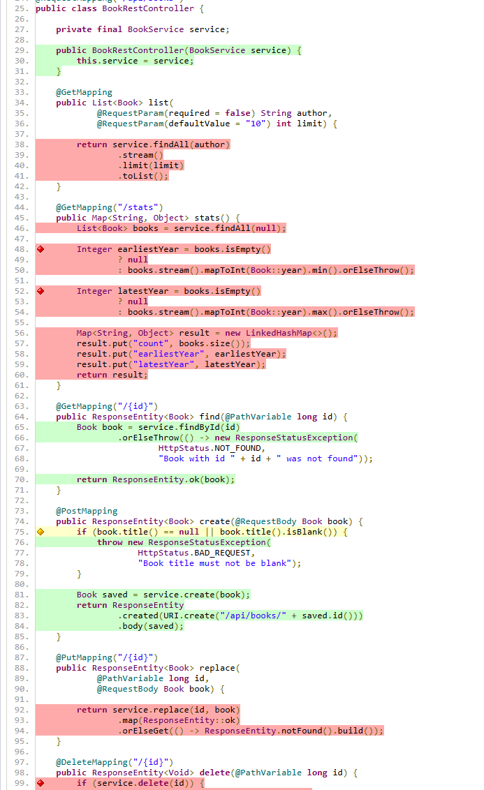
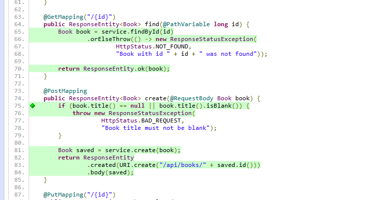

# Laboratory Work 12 — Test Evidence

Authors: Aitkuzhinov Arafat
Branch: `lab12`  
Variant 5: `MemberService` — membership expired yesterday, tested with a fixed clock.

## 1. Test results

| Test class | Tests run | Failures | Errors | Skipped |
|---|---:|---:|---:|---:|
| BookRepositoryTest | 2 | 0 | 0 | 0 |
| MemberServiceTest | 4 | 0 | 0 | 0 |
| BookControllerTest | 6 | 0 | 0 | 0 |
| **Total** | **12** | **0** | **0** | **0** |

These results are from the three selected test classes, not a full `clean verify` run.

## 2. Coverage before and after

| Metric | Before: 11 tests | After: 12 tests |
|---|---:|---:|
| Web package — branches covered | 3/10 (30%) | 4/10 (40%) |
| Whole project — branches covered | 5/30 (16% displayed) | 6/30 (20%) |
| Whole project — lines covered | 67/235 | 67/235 |
| Member package — lines and branches | 100% / 100% | 100% / 100% |

JaCoCo source view: `BookRestController.java`, line 75:

```java
if (book.title() == null || book.title().isBlank()) {
```

Before: yellow diamond, partially covered. The existing tests sent a valid
title and a title containing only spaces. Neither made `title() == null` true.

After: green diamond, fully covered. The new test `rejectsBookWhenTitleIsMissing`
omits the `title` field, expects HTTP 400, and verifies that the service is
never called. Branch coverage increased without covering a new source line.

One branch still worth testing is deletion when the book does not exist.
A test should verify that the API returns 404 rather than reporting a successful deletion.

**Before — line 75 is partially covered (yellow diamond):**



**After — line 75 is fully covered (green diamond):**



## 3. PostgreSQL integration test

Command: `.\mvnw.cmd "-Dtest=BookIntegrationTest" test`

The test compiled successfully. Its separate execution reported:
`Tests run: 1, Failures: 0, Errors: 1, Skipped: 0`.

Testcontainers reported: `Could not find a valid Docker environment`.
The `postgres:17-alpine` container did not start, so the HTTP create/read
scenario was not executed. This test is not counted as passed.

The two repository tests used H2 with Flyway disabled. They verified the
case-insensitive author query, but not PostgreSQL compatibility or the
Flyway migrations. The container test is intended to check those migrations
and a real HTTP create/read cycle against PostgreSQL.

## 4. Maven verification

Command: `.\mvnw.cmd "-Dtest=MemberServiceTest,BookControllerTest,BookRepositoryTest" clean verify`

Result: BUILD SUCCESS. JaCoCo 0.8.16 generated the HTML report during the
verify phase and analyzed 20 classes. Report: `target/site/jacoco/index.html`.

The selected suite contains 12 tests: 4 service, 6 controller, and 2 repository
tests. The PostgreSQL container test was run separately; see section 3.
